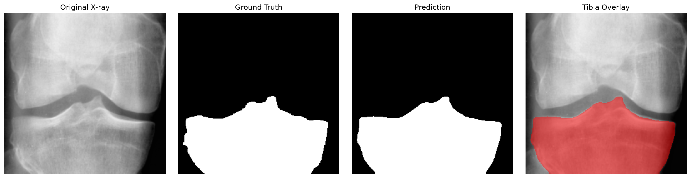
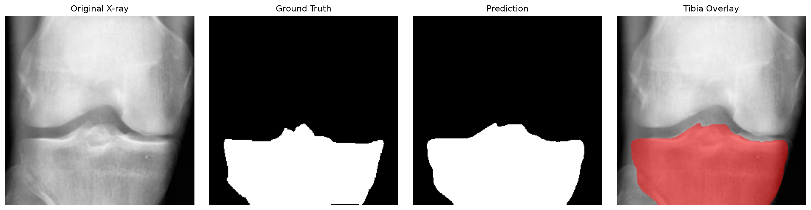
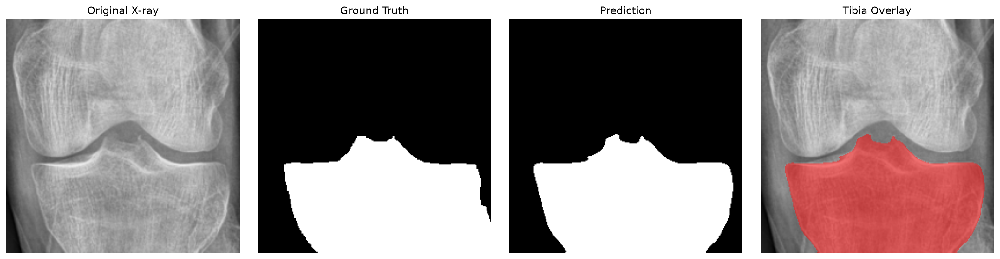
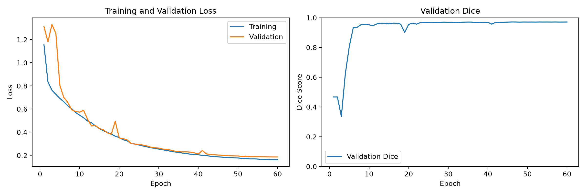
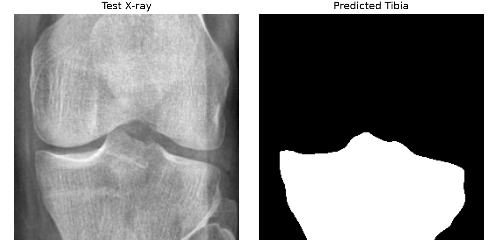
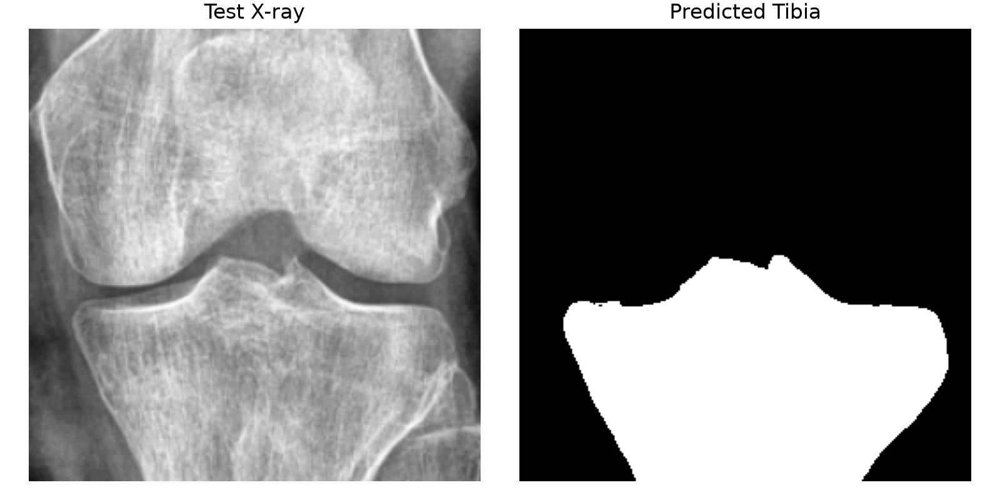

# Tibia Segmentation from Knee X-Ray Images Using U-Net

**Automatic tibia bone segmentation in knee radiographs using PyTorch and a U-Net convolutional neural network.**

This academic deep-learning project trains a U-Net model to identify the tibia in grayscale knee X-ray images and generate binary segmentation masks.

## Key Results

| Metric | Validation Performance |
|---|---:|
| Mean Dice coefficient | **97.11%** |
| Mean Intersection over Union (IoU) | **94.44%** |
| Mean precision | **97.09%** |
| Best training epoch | **46 / 60** |
| Model parameters | **1,963,809** |

**Evaluation note:** These metrics were calculated using 20 manually annotated validation images. The separate set of 50 unlabeled X-rays was used for prediction only, not quantitative testing.

## 1. Project Overview

The tibia is a major bone of the lower leg and an important anatomical structure visible in knee radiographs.

The objective of this project is to develop a deep-learning pipeline that automatically segments the tibia region from knee X-ray images.

The workflow includes:

1. Preparing and organizing knee X-ray images and segmentation masks.
2. Training a U-Net model using manually annotated examples.
3. Evaluating segmentation performance on a validation dataset.
4. Saving the best-performing model checkpoint.
5. Generating segmentation masks for previously unlabeled X-ray images.
6. Visualizing predictions, ground-truth masks, and training performance.

## 2. Dataset

The dataset contains **150 grayscale knee X-ray images**.

| Dataset Split | Images | Ground-Truth Masks | Purpose |
|---|---:|---|---|
| Training | 80 | Yes | Model training |
| Validation | 20 | Yes | Model evaluation and checkpoint selection |
| Unlabeled test set | 50 | No | Segmentation prediction |
| **Total** | **150** | **100** | |

The 100 annotated images were divided into 80 training images and 20 validation images. The remaining 50 images were reserved for prediction.

Images and segmentation masks are resized to **256 × 256 pixels**.

Dataset files are organized under `data/`, with split information stored in `data/CSVs/`.

## 3. Model Architecture

The segmentation model is based on **U-Net**, an encoder–decoder convolutional neural network designed for pixel-level image segmentation.

### Architecture components

- **Encoder:** Four downsampling stages extract increasingly abstract image features.
- **Bottleneck:** Processes features at the deepest level of the network.
- **Decoder:** Reconstructs the spatial resolution using bilinear upsampling.
- **Skip connections:** Combine encoder and decoder features to preserve spatial information.
- **Output layer:** Produces a single-channel prediction for binary tibia segmentation.

Convolutional blocks use batch normalization and ReLU activation.

**Total trainable parameters:** 1,963,809.

## 4. Training Methodology

The model was trained using the PyTorch deep-learning framework.

| Component | Configuration |
|---|---|
| Framework | PyTorch |
| Architecture | U-Net |
| Input resolution | 256 × 256 |
| Optimizer | AdamW |
| Loss function | Binary cross-entropy with logits + soft Dice loss |
| Training epochs | 60 |
| Batch size | 10 |
| Best checkpoint epoch | 46 |
| Checkpoint selection | Validation Dice coefficient |

The training pipeline also includes data augmentation, learning-rate scheduling, and model checkpoint saving.

### Training command

```bash
python main.py -epochs 60 -bs 10 -out_dir sessions/final
```

The selected checkpoint is stored at:

```text
sessions/final/best_tibia_unet.pth
```

## 5. Evaluation Results

The best-performing model was evaluated on the **20 annotated validation images**.

| Evaluation Metric | Result |
|---|---:|
| Mean Dice coefficient | **0.9711 (97.11%)** |
| Mean IoU | **0.9444 (94.44%)** |
| Mean precision | **0.9709 (97.09%)** |

These results indicate strong segmentation overlap on the validation split. However, they do not establish performance on an independent, annotated test dataset.

### Evaluation command

```bash
python evaluate.py
```

### Validation Segmentation Examples

The following visualizations illustrate the model's segmentation predictions on validation X-rays.







Additional examples are available in `demo_images/final/`.

### Training Performance

The following figure shows the recorded training performance.



## 6. Predictions on Unlabeled Images

The trained model was used to generate **50 binary tibia segmentation masks** for the unlabeled X-ray images.

Because these images do not have manually annotated ground-truth masks, quantitative metrics such as Dice and IoU cannot be calculated for this prediction set.

### Prediction Examples





All 50 generated masks are available in:

```text
demo_images/final/
```

with filenames `test_mask_001.png` through `test_mask_050.png`.

## 7. Project Structure

```text
Knee_Segmentation/
├── data/
│   ├── xrays/                 # 150 knee X-ray images
│   ├── masks/                 # 100 annotated tibia masks
│   └── CSVs/                  # Dataset split CSV files
├── sessions/
│   └── final/
│       ├── best_tibia_unet.pth
│       └── training_history.csv
├── demo_images/
│   └── final/                 # Validation and prediction visualizations
├── args.py                    # Command-line arguments
├── data_preparation.py        # Dataset preparation
├── dataset.py                 # Dataset loading
├── evaluate.py                # Evaluation
├── main.py                    # Training entry point
├── model.py                   # U-Net architecture
├── trainer.py                 # Training implementation
├── utils.py                   # Utility functions
├── requirements.txt           # Python dependencies
├── .gitignore
└── README.md
```

## 8. Installation and Usage

### Clone the repository

```bash
git clone https://github.com/rahulA725H/tibia-segmentation-unet.git
cd tibia-segmentation-unet
```

### Create a virtual environment

```bash
python -m venv .venv
```

On Windows PowerShell:

```powershell
.\.venv\Scripts\Activate.ps1
```

### Install dependencies

```bash
python -m pip install -r requirements.txt
```

### Train the model

```bash
python main.py -epochs 60 -bs 10 -out_dir sessions/final
```

### Evaluate the model

```bash
python evaluate.py
```

A pretrained checkpoint is included in `sessions/final/` for reference.

**Reproducibility note:** The installation and execution instructions describe the intended project workflow. Dependency compatibility and reproducibility on a fresh machine should be verified separately.

## 9. Limitations and Future Work

Although the validation results are promising, the project has several limitations:

- **Limited dataset size:** Only 100 manually annotated images were available for supervised training and validation.
- **Small validation set:** Quantitative performance was assessed using 20 validation images.
- **No annotated test set:** The 50 unlabeled images cannot provide independent quantitative performance estimates.
- **Generalization uncertainty:** Additional evaluation is needed across different imaging conditions, equipment, and patient populations.

Potential future improvements include obtaining additional annotations, conducting cross-validation, evaluating external datasets, and comparing U-Net with alternative segmentation architectures.

## 10. Disclaimer

This project is intended for **academic, research, and educational purposes only**.

The model has not been clinically validated and should not be used for medical diagnosis, treatment planning, or clinical decision-making.

## 11. Model License and Attribution

**Model architecture:** U-Net (Convolutional Neural Network for Biomedical Image Segmentation).

**Original authors:** Olaf Ronneberger, Philipp Fischer, and Thomas Brox (2015).

**Original publication:** *U-Net: Convolutional Networks for Biomedical Image Segmentation*.

**Reference:** https://doi.org/10.1007/978-3-319-24574-4_28

**Framework:** PyTorch.

**Model implementation:** The U-Net architecture is implemented in `model.py`, and the trained tibia segmentation checkpoint is stored in `sessions/final/best_tibia_unet.pth`.

**License status:** No explicit license has been specified for this project's model implementation or trained weights. The U-Net research publication is credited above; this attribution does not imply a particular software license.

Third-party dependencies and the dataset may have their own licensing terms.
